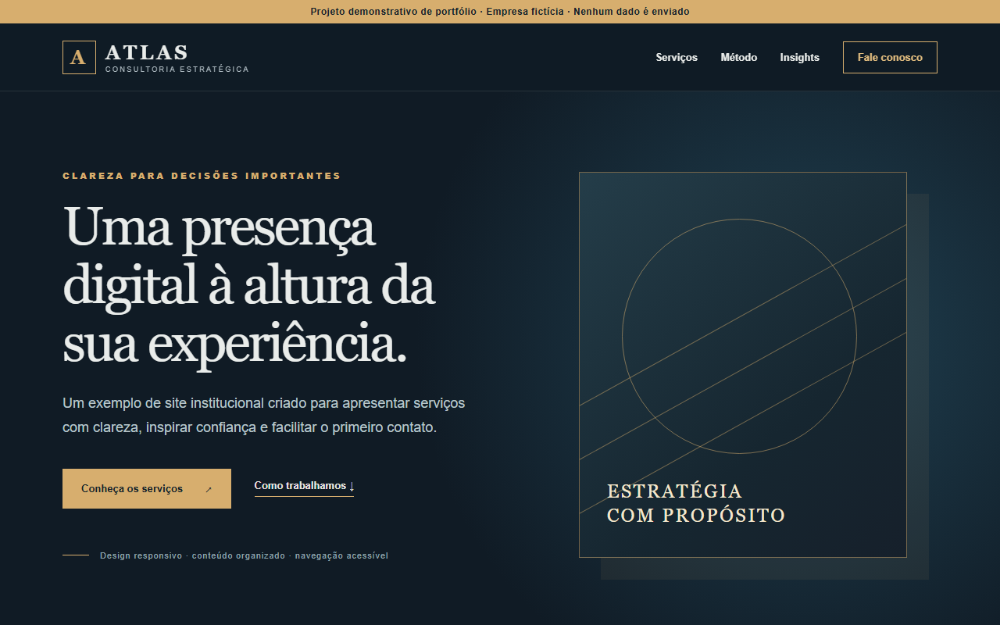

# Site institucional - interface de portfólio

Versão pública e fictícia inspirada no trabalho de criação de um site institucional real. Ela **não é o site de produção**: nomes, textos, imagens, contatos e integrações do cliente foram substituídos. O repositório original permanece privado e ligado ao seu próprio fluxo de implantação.

## Recursos

- Estrutura semântica com áreas de serviços, método, conteúdo e contato.
- Layout responsivo e navegação móvel acessível.
- Formulário com validação nativa e mensagem de retorno, **sem envio de dados**.
- Metadados básicos, link para pular ao conteúdo e estados de foco visíveis.

## Executar localmente

Não há dependências. Abra `index.html` no navegador ou sirva a pasta com `python -m http.server 8000` e acesse `http://localhost:8000`.

## Limites desta versão

Este projeto não contém backend, autenticação, atendimento, dados pessoais nem integrações de produção. A empresa Atlas é fictícia.
